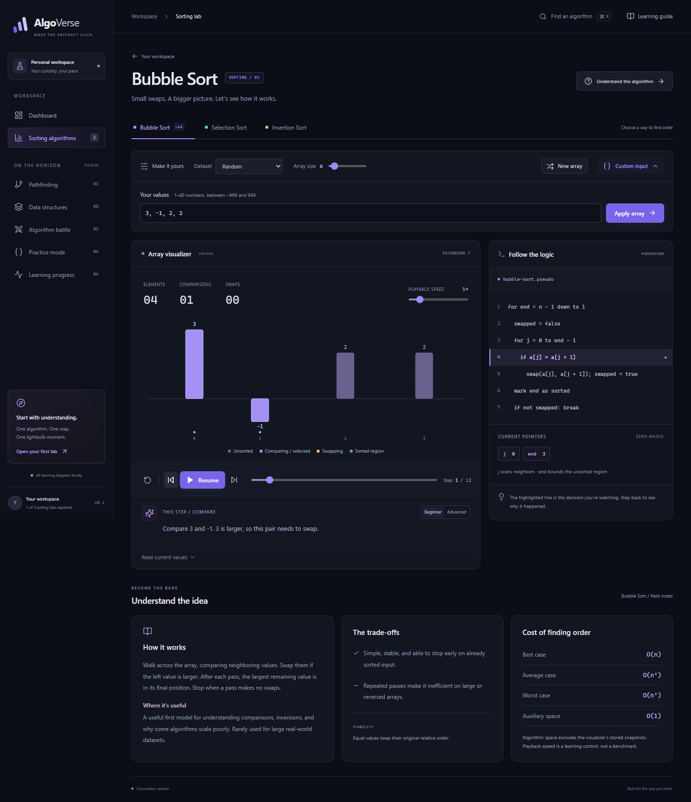
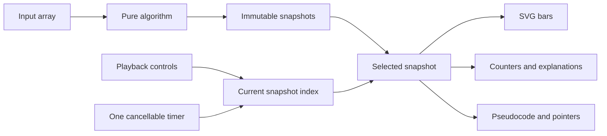

# AlgoVerse

**Build your intuition, one algorithm at a time.**

AlgoVerse is a browser-only algorithm learning workspace built with React and TypeScript. It combines animated sorting, reversible playback, real operation counts, and explanations tied to the exact algorithm state.

**[Deployed on Vercel — open AlgoVerse](https://algo-verse-blush-rho.vercel.app/)**

**Status: Phase 1 complete; sorting algorithms added.** Bubble, Selection, Insertion, Merge, Quick, and Heap Sort are implemented. Battle mode remains deferred. Later-phase navigation opens roadmap pages. There is no backend or account system.

## Screenshots

These are actual screenshots from the running application, captured by the browser tests.




[Mobile dashboard](docs/screenshots/dashboard-mobile.png) · [Mobile sorting lab](docs/screenshots/lab-mobile.png)

[Merge Sort with buffer — desktop](docs/screenshots/merge-desktop.png) · [Merge Sort — mobile](docs/screenshots/merge-mobile.png)

## What works

- Responsive dark workspace, dashboard, algorithm search (`Ctrl/Cmd + K`), and working routes.
- Six sorting labs: optimized Bubble Sort, Selection Sort, adjacent-swap Insertion Sort, buffered Merge Sort, last-pivot Quick Sort, and iterative Heap Sort.
- Play, pause, resume, replay, single-step forward/backward, reset, and timeline seeking.
- Speed control from 0.5× to 4×; generated arrays from 1–40 elements.
- Random, reversed, nearly sorted, and duplicate-heavy inputs.
- Custom arrays, including negative values, duplicates, zero, and decimals, with validation.
- Animated SVG bars with stable item identities, a zero baseline, state colors, and a text readout.
- Exact comparison/swap counts (main-array writes for Merge Sort), highlighted pseudocode, and current pointer indices.
- Merge Sort's temporary buffer is shown alongside the pseudocode and restored during backward playback.
- Beginner/advanced operation explanations, algorithm intuition, applications, and complexity notes.
- Persisted playback preferences and recently opened labs. No fabricated learning statistics.
- Reduced-motion support, keyboard-accessible controls, labeled inputs, visible focus, and recoverable invalid routes.
- Automated algorithm, playback, input, persistence, and desktop/mobile browser tests.

## Stack

React · TypeScript · Vite · Tailwind CSS · Motion for React · Lucide React · React Router · Vitest · Testing Library · Playwright

Tailwind's Vite plugin supplies utilities, while `src/styles.css` defines the product's visual system. Motion animates SVG positions; no canvas is needed for the Phase 1 bar chart. The dependency lockfile is included.

## Run locally

Use **Node.js 22.12+** (an LTS release is recommended) and npm. Open a terminal in this project directory:

```sh
npm ci
npm run dev
```

Open the Local URL Vite prints, normally **http://127.0.0.1:5173**. `npm ci` is only needed for a fresh checkout or a changed lockfile. Do not open `index.html` directly from the filesystem.

### Commands

| Command                | Purpose                                                      |
| ---------------------- | ------------------------------------------------------------ |
| `npm run dev`          | Start the local Vite development server                      |
| `npm run typecheck`    | Check strict TypeScript types                                |
| `npm run lint`         | Run ESLint with zero warnings allowed                        |
| `npm run format`       | Format source and documentation with Prettier                |
| `npm run format:check` | Verify consistent formatting without changing files          |
| `npm test`             | Run the 121 unit/integration tests once                      |
| `npm run test:watch`   | Watch unit/integration tests during development              |
| `npm run build`        | Type-check and generate the production `dist/` directory     |
| `npm run preview`      | Serve the production build locally                           |
| `npm run check`        | Run type-check, lint, unit tests, and production build       |
| `npm run test:e2e`     | Run 14 browser scenarios across desktop and mobile viewports |

### Browser tests

For a fresh environment, install the Playwright browser once:

```sh
npx playwright install chromium
npm run test:e2e
```

You can use an existing Chrome installation instead. In PowerShell:

```powershell
$env:PLAYWRIGHT_CHANNEL = 'chrome'
npm run test:e2e
```

On macOS/Linux:

```sh
PLAYWRIGHT_CHANNEL=chrome npm run test:e2e
```

The browser suite starts and closes its own Vite server on **5174**, independently of your development server. It captures real screenshots in `docs/screenshots/`. Mobile tests emulate a 390px iPhone viewport in Chromium; they are not a claim of testing a physical iPhone or Safari.

## Architecture

```text
src/
  algorithms/sorting/   Pure sorting functions and immutable trace builder
  components/          Playback controls, educational panels, search, error boundary
  data/                Typed educational content and pseudocode
  hooks/               Playback state machine, scheduler, local preferences
  layouts/             Sidebar, header, footer, and route outlet
  pages/               Dashboard, sorting workspace, roadmap, not-found page
  tests/               Algorithm, playback, input, and storage tests
  types/               Shared algorithm and snapshot contracts
  utils/               Input parsing, array generation, resilient storage
  visualizers/         SVG rendering of a single snapshot
e2e/                   Desktop/mobile interaction tests and owned preview server
docs/                  Learning walkthrough and actual screenshots
```



Every snapshot stores array items, operation type, active/sorted indices, pointer positions, cumulative counts, explanation text, and a pseudocode line. A bar keeps its original ID even when another bar has the same value.

Stepping backward changes the current index. It does not reverse a swap or rerun the algorithm, so all visible state is restored together, including Merge Sort's buffer and write count. Seeking, manual stepping, resetting, changing the input, or switching algorithms pauses playback. Switching algorithms starts a fresh lab; identical-input battle comparisons remain deferred.

The algorithms contain **no timers, random generation, React imports, or DOM access**. `usePlayback` owns one cancellable timer. SVG animation only interpolates between snapshots and cannot change algorithm correctness.

## Understanding the algorithms

| Algorithm      | Core idea                                                                | Best                   | Average / worst                  | Auxiliary space      | Stable? |
| -------------- | ------------------------------------------------------------------------ | ---------------------- | -------------------------------- | -------------------- | ------- |
| Bubble Sort    | Swap adjacent inversions; finalize the largest remaining value each pass | O(n)                   | O(n²)                            | O(1)                 | Yes     |
| Selection Sort | Find the minimum of the unsorted region; swap it into position           | O(n²)                  | O(n²)                            | O(1)                 | No      |
| Insertion Sort | Move each new value left into the sorted prefix using adjacent swaps     | O(n)                   | O(n²)                            | O(1)                 | Yes     |
| Merge Sort     | Recursively sort halves and merge through a temporary buffer             | O(n log n)             | O(n log n)                       | O(n)                 | Yes     |
| Quick Sort     | Partition around the last item, then recursively sort both sides         | O(n log n)             | O(n log n) average / O(n²) worst | O(n) worst recursion | No      |
| Heap Sort      | Build a max heap, then repeatedly extract its root                       | O(n) with equal values | O(n log n)                       | O(1)                 | No      |

“Comparisons” counts value comparisons, not loop-bound checks. “Swaps” counts pairwise exchanges; even adjacent-swap Insertion Sort uses this definition. No wall-clock benchmark is presented. Increasing playback speed changes the learning experience, not algorithm performance.

Merge Sort takes the left item on equal comparisons, preserving stability. Its buffer grows as values are selected, then an `overwrite` snapshot commits the complete merged run. The **array writes** counter increases by the run length; it excludes temporary-buffer writes and is not labeled as swaps. Grouped write-back keeps every main-array snapshot a permutation with unique item IDs, which also keeps backward playback and bar animation reliable.

Quick Sort deliberately uses a deterministic last-element pivot. Its average bound assumes randomly ordered input; sorted, reversed, and all-equal inputs exhibit quadratic comparisons. Recursive stack space is O(log n) for balanced partitions and O(n) in the worst case. Heap Sort uses iterative sift-down. Its linear best case applies to equal values; for distinct keys its best case is O(n log n), as discussed in [Princeton's priority queue notes](https://algs4.cs.princeton.edu/24pq/).

Insertion Sort's green prefix and Merge Sort's green run are **sorted relative to themselves**, not finalized: later operations may move their items. Bubble Sort's sorted suffix, Selection Sort's sorted prefix, Quick Sort's marked pivots, and Heap Sort's sorted suffix are finalized.

The space figures describe the underlying algorithms, excluding trace instrumentation. Recording full immutable snapshots costs **O(n × number of steps)** additional memory, or O(n³) for quadratic traces and O(n² log n) for the Merge/Heap traces. Inputs are capped at 40 values to keep this educational design responsive. A compact operation log with periodic checkpoints is a potential future optimization, not an implemented feature.

See [the Phase 1 walkthrough](docs/PHASE-1-WALKTHROUGH.md) for a guided reading order and a concrete example.

The new implementations are in `src/algorithms/sorting/mergeSort.ts`, `quickSort.ts`, and `heapSort.ts`. Their educational metadata is in `src/data/algorithms.ts`. `trace.ts` adds the frozen buffer and main-array write count; the existing playback reducer and scheduler are unchanged. The selectors, dashboard cards, search, and saved recent-lab validation now accept all six IDs.

## Validation

The unit suite covers empty/singleton arrays, sorted/reversed input, duplicates, negative values, decimals, invalid numbers, immutable snapshots, exact operation transitions, stability, and algorithm-specific counts. It also checks 960 seeded generated inputs across all six algorithms. New guarantees cover stable merge choices and write counts, finalized Quick Sort partitions, max-heap invariants before extraction, and backward restoration after writes/swaps.

Playback tests verify exact backward restoration, clamped seeking, pause/resume, replay, timer cancellation, speed changes, reset, and unmount cleanup. Browser scenarios exercise actual controls, custom inputs, navigation, persisted preferences, corrupt storage recovery, responsive width, and all six sorting labs.

The configuration preserves paths in sandboxed Windows checkouts to avoid native `realpath` restrictions. Vitest workers disable Node's experimental Web Storage so jsdom owns browser storage consistently on Node 25. Neither setting changes application behavior in a browser.

## Local data

Only `algoverse:preferences` and `algoverse:recent` are written to localStorage. Preferences hold array size, speed, and explanation level. Recent entries are actual lab routes opened by the user; they do not claim lesson completion or mastery. Invalid or inaccessible storage falls back safely. You can clear these keys using your browser's developer tools.

## Later phases — not implemented

1. **Deferred Phase 2 feature:** sorting battle mode.
2. **Phase 3:** Pathfinding grids; Dijkstra, A\*, BFS, and DFS; terrain and mazes.
3. **Phase 4:** Practice challenges, TypeScript/Python code mode, lesson completion and accuracy tracking.
4. **Phase 5:** Data structure labs and further accessibility/performance refinement.

The app is deployed on Vercel at [algo-verse-blush-rho.vercel.app](https://algo-verse-blush-rho.vercel.app/). The Vercel configuration provides the SPA fallback for client-side routes.
